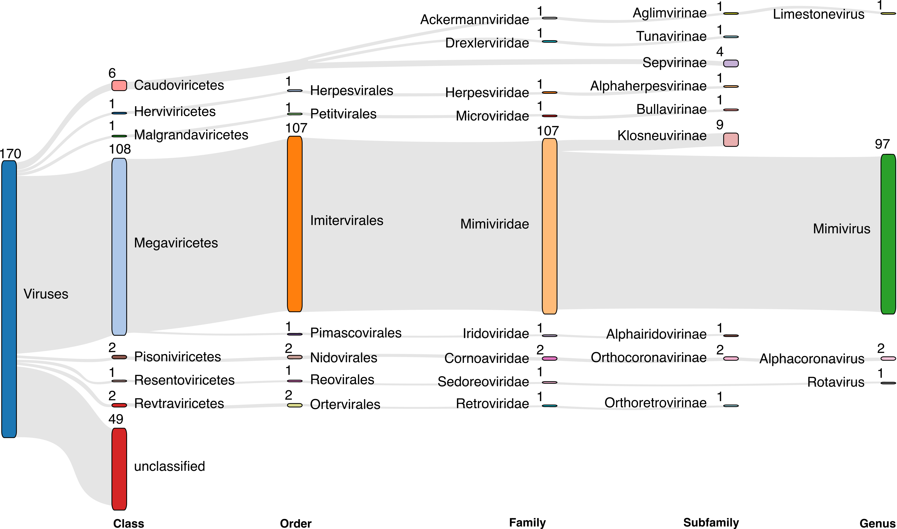

# Output

## Table of contents

- [Results](#results)
- [GFF output files](#gff-output-files)
  - [When the prediction tools disagree](#when-the-prediction-tools-disagree)

## Results

The outputs generated from viral prediction tools, ViPhOG annotation, taxonomy assign, and CheckV quality are integrated and summarized in a validated gff file.
By default pipeline produces the `08-final` folder, and also the CheckV results and the VirSorter2,
VirFinder and PPR-Meta tables. Those files can be used to check why a contig is in its category
(see [When the prediction tools disagree](#when-the-prediction-tools-disagree)).

Structure example per-assembly

    not_matched_proteins_report.tsv

    01-predictions
        ├── pprmeta
        │   └── ACCESSION_pprmeta.csv
        ├── virfinder
        │   └── ACCESSION_virfinder.tsv
        └── virsorter2 [not with --use_virsorter_v1, except virsorter_metadata.tsv]
            ├── final-viral-boundary.tsv
            ├── final-viral-score.tsv
            └── virsorter_metadata.tsv
    07-checkv
        ├── high_confidence_viral_contigs_quality_summary.tsv
        ├── low_confidence_viral_contigs_quality_summary.tsv
        └── prophages_quality_summary.tsv
    08-final
        ├── annotation
        │   ├── hmmer
        │   │   ├── high_confidence_viral_contigs_split_annotation.tsv
        │   │   ├── low_confidence_viral_contigs_split_annotation.tsv
        │   │   └── prophages_split_annotation.tsv
        │   └── plot_contig_map
        │       ├── high_confidence_viral_contigs_mapping_results
        │       │   ├── high_confidence_viral_contigs_prot_ann_table_filtered.tsv
        │       │   └── plot_pdfs.tar.gz
        │       ├── low_confidence_viral_contigs_mapping_results
        │       │   ├── low_confidence_viral_contigs_prot_ann_table_filtered.tsv
        │       │   └── plot_pdfs.tar.gz
        │       └── prophages_mapping_results
        │           ├── plot_pdfs.tar.gz
        │           └── prophages_prot_ann_table_filtered.tsv
        ├── contigs
        │   ├── ACCESSION_map.tsv
        │   ├── ACCESSION_renamed_original.fasta
        │   ├── high_confidence_viral_contigs_original.fasta
        │   ├── low_confidence_viral_contigs_original.fasta
        │   └── prophages_original.fasta
        ├── chromomap [optional step]
        ├── ACCESSION_detection_evidence.tsv
        ├── gff
        │   ├── ACCESSION_virify.gff.gz
        │   ├── ACCESSION_virify.gff.gz.csi
        │   └── ACCESSION_virify.gff.gz.gzi
        ├── krona
        │   ├── ACCESSION.all.krona.html
        │   ├── high_confidence_viral_contigs.krona.html
        │   ├── low_confidence_viral_contigs.krona.html
        │   └── prophages.krona.html
        └── sankey
            ├── ACCESSION.all.sankey.html
            ├── high_confidence_viral_contigs.sankey.html
            ├── low_confidence_viral_contigs.sankey.html
            └── prophages.sankey.html

To get the output of all the steps, use the `--publish_all` option in pipeline execution.

Expanded structure example per-assembly

    not_matched_proteins_report.tsv

    ├── 01-predictions
    │   ├── ACCESSION_virus_predictions.stats
    │   ├── pprmeta
    │   │   └── ACCESSION_pprmeta.csv
    │   ├── virfinder
    │   │   └── ACCESSION_virfinder.tsv
    │   └── virsorter2
    │       ├── final-viral-boundary.tsv
    │       ├── final-viral-combined.fa
    │       ├── final-viral-score.tsv
    │       └── virsorter_metadata.tsv
    ├── 02-protein-prediction [if proteins_faa and proteins_gff were not provided as input]
    │   ├── ACCESSION.faa.gz
    │   ├── ACCESSION.gff.gz
    │   └── ACCESSION.fna.gz
    ├── 03-hmmer
    │   ├── high_confidence_viral_contigs_modified.tsv
    │   ├── low_confidence_viral_contigs_modified.tsv
    │   ├── prophages_modified.tsv
    │   ├── ratio_evalue_tables
    │   │   ├── high_confidence_viral_contigs_modified_informative.tsv
    │   │   ├── low_confidence_viral_contigs_modified_informative.tsv
    │   │   └── prophages_modified_informative.tsv
    │   └── vpHMM_database_v3
    │       ├── high_confidence_viral_contigs*_vpHMM_database_v3_hmmsearch.tbl
    │       ├── low_confidence_viral_contigs*_vpHMM_database_v3_hmmsearch.tbl
    │       └── prophages*_vpHMM_database_v3_hmmsearch.tbl
    │   └── [other chosen optional HMM DBs]
    ├── 04-blast [optional step]
    ├── 05-plots
    │   ├── krona
    │   │   ├── ACCESSION.counts.tsv
    │   │   ├── high_confidence_viral_contigs.counts.tsv
    │   │   ├── low_confidence_viral_contigs.counts.tsv
    │   │   └── prophages.counts.tsv
    │   └── sankey
    │       ├── all.sankey.filtered-25.json
    │       ├── all.sankey.tsv
    │       ├── high_confidence_viral_contigs.sankey.filtered-25.json
    │       ├── high_confidence_viral_contigs.sankey.tsv
    │       ├── low_confidence_viral_contigs.sankey.filtered-25.json
    │       ├── low_confidence_viral_contigs.sankey.tsv
    │       ├── prophages.sankey.filtered-25.json
    │       └── prophages.sankey.tsv
    ├── 06-taxonomy
    │   ├── high_confidence_viral_contigs_annotation_taxonomy.tsv
    │   ├── low_confidence_viral_contigs_annotation_taxonomy.tsv
    │   └── prophages_annotation_taxonomy.tsv
    ├── 07-checkv
    │   ├── high_confidence_viral_contigs_quality_summary.tsv
    │   ├── low_confidence_viral_contigs_quality_summary.tsv
    │   └── prophages_quality_summary.tsv
    └── 08-final
        ├── annotation
        │   ├── hmmer
        │   │   ├── high_confidence_viral_contigs_*_annotation.tsv
        │   │   ├── low_confidence_viral_contigs_*_annotation.tsv
        │   │   └── prophages_*_annotation.tsv
        │   └── plot_contig_map
        │       ├── high_confidence_viral_contigs_mapping_results
        │       │   ├── high_confidence_viral_contigs_prot_ann_table_filtered.tsv
        │       │   └── plot_pdfs.tar.gz
        │       ├── low_confidence_viral_contigs_mapping_results
        │       │   ├── low_confidence_viral_contigs_prot_ann_table_filtered.tsv
        │       │   └── plot_pdfs.tar.gz
        │       └── prophages_mapping_results
        │           ├── plot_pdfs.tar.gz
        │           └── prophages_prot_ann_table_filtered.tsv
        ├── contigs
        │   ├── ACCESSION_map.tsv
        │   ├── ACCESSION_renamed_original.fasta
        │   ├── high_confidence_viral_contigs_original.fasta
        │   ├── low_confidence_viral_contigs_original.fasta
        │   └── prophages_original.fasta
        ├── chromomap [optional step]
        ├── ACCESSION_detection_evidence.tsv
        ├── ACCESSION_no_proteins.tsv [only if contigs were dropped]
        ├── high_confidence_viral_contigs_no_proteins.tsv [only if contigs were dropped]
        ├── low_confidence_viral_contigs_no_proteins.tsv [only if contigs were dropped]
        ├── prophages_no_proteins.tsv [only if contigs were dropped]
        ├── gff
        │   ├── ACCESSION_virify.gff.gz
        │   ├── ACCESSION_virify.gff.gz.csi
        │   └── ACCESSION_virify.gff.gz.gzi
        ├── krona
        │   ├── ACCESSION.all.krona.html
        │   ├── high_confidence_viral_contigs.krona.html
        │   ├── low_confidence_viral_contigs.krona.html
        │   └── prophages.krona.html
        └── sankey
            ├── ACCESSION.all.sankey.html
            ├── high_confidence_viral_contigs.sankey.html
            ├── low_confidence_viral_contigs.sankey.html
            └── prophages.sankey.html

### Contigs without proteins

VIRify annotates viral contigs through their proteins, so a contig with no coding sequence cannot be
annotated and is discarded. The `*_no_proteins.tsv` files record every contig dropped this way, so a
contig missing from the final GFF can always be accounted for. They are written at the two points
where the situation can arise, and only when that step actually dropped something: a run where every
contig kept its proteins produces no such file.

| File (with `--publish_all`) | Stage | Contents |
|---|---|---|
| `08-final/ACCESSION_no_proteins.tsv` | before the prediction tools | contigs with no CDS in the proteins GFF, dropped before detection runs |
| `08-final/<category>_no_proteins.tsv` | after prophage prediction | contigs of that category that kept no proteins, either because the contig has no CDS or because none of its CDS fall inside the predicted prophage interval |

The second case only arises for prophages: a prophage interval can contain no CDS even on a contig
that is otherwise protein-rich, and the interval is not known until the predictions have been parsed.

If every category of a sample loses all of its proteins, the sample produces no final GFF and a
warning naming it is printed to the Nextflow log.

### GFF output files

You can find such output in the `08-final/gff/` folder.

The labels used in the Type column of the gff file correspond to the following nomenclature according to the [Sequence Ontology resource](http://www.sequenceontology.org/browser/current_svn/term/SO:0000001):

| Type in gff file  | Sequence ontology ID |
| ------------- | ------------- |
| viral_sequence  | [SO:0001041](http://www.sequenceontology.org/browser/current_svn/term/SO:0001041) |
| prophage  | [SO:0001006](http://www.sequenceontology.org/browser/current_svn/term/SO:0001006) |
| CDS | [SO:0000316](http://www.sequenceontology.org/browser/current_svn/term/SO:0000316) |

The GFF reports all the CDS of each viral sequence. A CDS has the `viphog` and `viphog_taxonomy`
attributes only when a ViPhOG match has been found.

#### Attributes of `viral_sequence` and `prophage` features

| Attribute | Values | Description |
|---|---|---|
| `ID` | `<contig>\|viral_sequence` or `<contig>\|prophage-<start>:<end>` | Identifier of the feature. |
| `virify_quality` | `HC`, `LC`, `PP` | VIRify category: high confidence, low confidence or putative prophage. |
| `mobile_element_type` | `phage_linear`, `phage_circular`, `prophage` | `phage_circular` is set only when VirSorter (`--use_virsorter_v1`) or VirSorter2 calls the contig circular. `phage_linear` is the default value. It does not prove that the genome is linear. |
| `checkv_provirus` | `Yes`, `No` | CheckV `provirus` column. |
| `checkv_quality` | for example `Complete`, `High-quality`, `Low-quality` | CheckV `checkv_quality` column. |
| `checkv_miuvig_quality` | for example `High-quality`, `Genome-fragment` | CheckV `miuvig_quality` column. |
| `checkv_kmer_freq` | number | CheckV `kmer_freq` column. A value higher than 1 can show a duplicated genome. |
| `checkv_viral_genes` | number | CheckV `viral_genes` column. |
| `taxonomy` | lineage or `unclassified` | ViPhOG-based lineage. The ranks are separated by `%3B` (an encoded `;`). |

Each `viral_sequence` and `prophage` feature gets the CheckV values of its own sequence. When
CheckV has no row for a sequence, the `checkv_*` attributes are `NA`. When CheckV cannot estimate
the quality of a sequence, it still writes a row: the GFF then has `checkv_quality=Not-determined`
and the other values of that row.

The GFF has only a part of the CheckV results. For example, it does not have the completeness
method, such as a direct terminal repeat (DTR). The full CheckV results are in
`07-checkv/<category>_quality_summary.tsv`.

#### Attributes of `CDS` features

| Attribute | Description |
|---|---|
| `ID` | Protein identifier. |
| `virify_quality` | VIRify category of the CDS (see below). |
| `viphog` | Best ViPhOG match. Only when a match has been found. |
| `viphog_taxonomy` | Taxonomic label of the best ViPhOG match. Only when a match has been found. |

#### When the prediction tools disagree

The prediction tools can disagree about a contig. For example, VirSorter2 finds a prophage in a
part of the contig, and VirFinder calls the whole contig viral. Then the contig matches a `PP` rule
and an `LC` rule.

VIRify puts each contig in one category only. When more than one category is possible, VIRify uses
this priority (with VirSorter2, and with VirSorter v1 under `--use_virsorter_v1`):

| Priority | Category | Call |
|---|---|---|
| 1 | `HC` | VirSorter calls the whole contig viral, with high confidence. |
| 2 | `PP` | VirSorter calls a part of the contig a prophage. |
| 3 | `LC` | One of these: a VirFinder score of 0.9 or more; a VirFinder score from 0.7 to 0.9 and a low-confidence VirSorter call; a VirFinder score from 0.7 to 0.9 and a PPR-Meta `phage` call. |

Only VirSorter can give `HC` or `PP`. VirFinder and PPR-Meta can give only `LC`. PPR-Meta never
calls a contig alone: its `phage` call counts only with a VirFinder score from 0.7 to 0.9. Each
VirFinder score must also have a p-value below 0.05. The rule names are in the
[Detection evidence table](#detection-evidence-table) section.

`PP` has priority over `LC` because the two tools give different types of results. VirSorter
examines the genes of the contig and finds the start and the end of the viral region. VirFinder
gives one score for the whole contig, so a prophage inside the contig can be sufficient for a
high score.

The rules that matched but were not kept are in the `dropped_calls` column of the detection
evidence table (see [Detection evidence table](#detection-evidence-table)). For example:

| contig | virify_quality | rule | dropped_calls | virfinder_score | pprmeta_possible_source |
|---|---|---|---|---|---|
| contig1 | PP | virsorter2_prophage | LC:virfinder_score_0.9 | 0.983 | phage |

Here VIRify reports only the prophage region (`PP`), and the GFF has only the `prophage` feature.

VIRify selects the category before it splits the proteins into the categories. A CDS stays in a
prophage only when more than 90% of the CDS, or more than 90% of the prophage, is inside the
other. Thus a prophage region can keep no CDS, for example when the CDS in the proteins GFF do not
agree with the genes that VirSorter used. Then the contig is not in the final GFF, also when a
dropped call (for example `LC`) would have kept it. VIRify does not use the dropped call instead.
The contig is in `08-final/prophages_no_proteins.tsv` (with `--publish_all`, see
[Contigs without proteins](#contigs-without-proteins)), and its row stays in the detection evidence
table.

If you think that the dropped call is correct, for example for a complete phage genome, use the
values in the table and the files below to check it:

| Evidence | File | Published | Contig names |
|---|---|---|---|
| Rule, dropped calls, tool values and CheckV quality for each HC, LC and PP sequence | `08-final/ACCESSION_detection_evidence.tsv` | Always | GFF names with a suffix (see below) |
| CheckV results for each category, including the completeness method | `07-checkv/<category>_quality_summary.tsv` | Always | GFF names with a suffix (see below) |
| VirSorter2 scores, groups (for example `ssDNA`) and boundaries | `01-predictions/virsorter2/final-viral-{score,boundary}.tsv` | Always | Temporary names |
| VIRify parse of the VirSorter2 results (category, circular, prophage range) | `01-predictions/virsorter2/virsorter_metadata.tsv` | Always | Temporary names |
| VirSorter2 viral sequences | `01-predictions/virsorter2/final-viral-combined.fa` | With `--publish_all` | Temporary names |
| VirFinder scores | `01-predictions/virfinder/ACCESSION_virfinder.tsv` | Always | Temporary names |
| PPR-Meta calls | `01-predictions/pprmeta/ACCESSION_pprmeta.csv` | Always | Temporary names |

VirFinder and PPR-Meta score every contig of the assembly, not only the viral contigs. The pipeline
runs them on chunks of the assembly and publishes one table for each tool, merged from the chunks.

The prediction tools run on temporary contig names. To link them to the names in the GFF, use
`08-final/contigs/ACCESSION_map.tsv`. Its columns are `original` (the full FASTA header),
`temporary` (the name used by the prediction tools) and `short` (the name used in the GFF).

##### Detection evidence table

`08-final/ACCESSION_detection_evidence.tsv` has one row for each HC, LC and PP sequence.
A contig with more than one prophage has one row for each prophage. Contigs that VIRify did not
call are not in the table. If VIRify calls no sequence, the pipeline does not write the table.
`NA` means that the tool has no value for the sequence.

| Column | Description |
|---|---|
| `sequence_id` | Sequence ID, in the same format as the CheckV `contig_id` (see below). |
| `contig` | Contig name, as in GFF column 1. |
| `virify_quality` | `HC`, `LC` or `PP`. |
| `rule` | The rule that put the sequence in its category (see below). |
| `dropped_calls` | The other rules that matched the contig but were not kept, as `<category>:<rule>`, separated by `,`. A prophage call has its range: `PP:<rule>:<start>-<end>`. `NA` when only one rule matched. See [When the prediction tools disagree](#when-the-prediction-tools-disagree). |
| `prophage_start`, `prophage_end` | Prophage coordinates from VirSorter. Only for `PP`. |
| `circular` | `True` when VIRify calls the sequence circular (`phage_circular` in the GFF). |
| `virfinder_score`, `virfinder_pvalue` | VirFinder `score` and `pvalue` of the contig. |
| `pprmeta_possible_source`, `pprmeta_phage_score` | PPR-Meta `Possible_source` and `phage_score` of the contig. |
| `virsorter_category` | VirSorter category (1 to 5). Only with `--use_virsorter_v1`. |
| `virsorter2_max_score`, `virsorter2_max_score_group` | VirSorter2 `max_score` and `max_score_group` (for example `dsDNAphage` or `ssDNA`). |
| `virsorter2_shape` | VirSorter2 `shape` of the contig (for example `circular`). VIRify sets a prophage to linear, but this column keeps the VirSorter2 value. |
| `checkv_quality`, `miuvig_quality`, `completeness`, `completeness_method`, `contamination` | Values of the CheckV row whose `contig_id` is the `sequence_id`. A `contig_id` without the `\|phage-circular` suffix also matches. `NA` if CheckV did not run on the category, for example because the category has no proteins. |

For `PP` rows, the VirSorter columns have the values of the prophage call. For `HC` and `LC` rows,
they have the values of the whole-contig call, if VirSorter made one.

The `rule` and `dropped_calls` columns have these values. `virsorter` is `virsorter2`, unless the
pipeline ran with `--use_virsorter_v1`. When more than one rule matches, VIRify keeps the first
rule of this table.

| Rule | Category | Meaning |
|---|---|---|
| `virsorter_high_confidence` | HC | VirSorter category 1 or 2, or VirSorter2 score at or above the cutoff (0.9 by default). |
| `virsorter_prophage` | PP | VirSorter category 4 or 5, or a VirSorter2 partial sequence. |
| `virfinder_score_0.9` | LC | VirFinder score at or above 0.9 and p-value below 0.05. |
| `virsorter_low_confidence_and_virfinder_score_0.7` | LC | VirSorter category 3 or VirSorter2 score below the cutoff, and VirFinder score from 0.7 to 0.9 with p-value below 0.05. |
| `pprmeta_phage_and_virfinder_score_0.7` | LC | PPR-Meta source `phage`, and VirFinder score from 0.7 to 0.9 with p-value below 0.05. |

##### Link CheckV rows to GFF features

The CheckV `contig_id` and the GFF use different forms of the same name. The `sequence_id`
column of the detection evidence table has the same format as the CheckV `contig_id`.

| Sequence | CheckV `contig_id` | GFF column 1 (seqid) | GFF feature `ID` |
|---|---|---|---|
| HC or LC contig | `<contig>` | `<contig>` | `<contig>\|viral_sequence` |
| Circular HC or LC contig | `<contig>\|phage-circular` | `<contig>` | `<contig>\|viral_sequence` |
| Prophage | `<contig>\|prophage-<start>:<end>` | `<contig>` | `<contig>\|prophage-<start>:<end>` |

For a prophage, the CheckV `contig_id` has the coordinates from VirSorter. The GFF feature can
have different coordinates:

- A start of `0` becomes `1`, because GFF coordinates start at 1.
- An end after the end of the contig becomes the contig length. VirSorter2 can give such an end
  for a circular genome.

Thus, to link a CheckV row to a GFF feature:

1. Remove the `|phage-circular` and `|prophage-<start>:<end>` suffixes from the CheckV
   `contig_id`. The result is the GFF seqid.
2. For a prophage, use the prophage start in the CheckV `contig_id` (`0` is `1` in the GFF) to
   find the `prophage` feature on that seqid. Do not use the end, because the GFF can change it.
